# How to use SetSetal

SetSetal helps residents of Brikama find someone to collect their waste. Three kinds of people use it:

- **[Residents](#residents)** look for a collector and contact them. They never sign in.
- **[Collectors](#collectors)** list their service and keep it up to date.
- **[Admins](#admins)** (the SetSetal team) check every listing before residents see it, and deal with reports.

> **About the pictures.** Every collector, name and phone number shown here is invented. The pictures were taken from the real app running against a stand-in for the server (`npm run guide:screenshots` retakes them), because the live service has not been switched on yet. Before it is, the app shows six examples marked **Demonstration listing** instead of real collectors. [What still has to be switched on](#before-the-first-real-use) is at the end.

## Opening and installing the app

Open **https://setsetal.netlify.app** in Chrome on an Android phone, or scan the QR code on the poster (`docs/pilot/poster.svg`).

To keep it on the phone like any other app, tap **Install app** on the home screen. The button appears a few seconds after the page opens, in Chrome on Android. On an iPhone, use Safari's Share button and choose **Add to Home Screen**.

Once installed, the app opens without a connection and shows the listings it last saved.

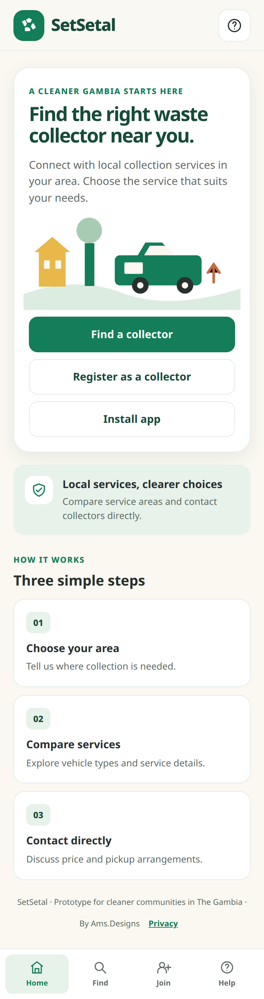

The four buttons at the bottom are on every screen: **Home**, **Find**, **Join** (for collectors) and **Help**. The phone's own back button goes back one screen at a time.

---

## Residents

### 1. Find a collector

Tap **Find a collector**, or **Find** at the bottom. Every collector the team has approved is listed.

A green **Collecting today** label means the collector has said they are working today. Those are listed first; the rest are in alphabetical order. Nobody can pay to be higher.

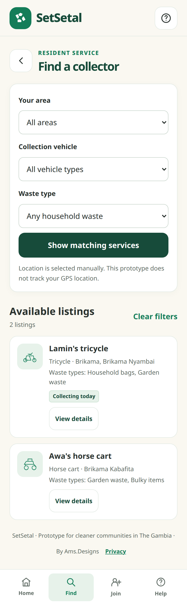

### 2. Narrow it down

Choose **Your area**, a **Collection vehicle** or a **Waste type**, then tap **Show matching services**. **Clear filters** shows everything again.

You pick your area from a list. SetSetal never asks for your address and never uses your phone's location.

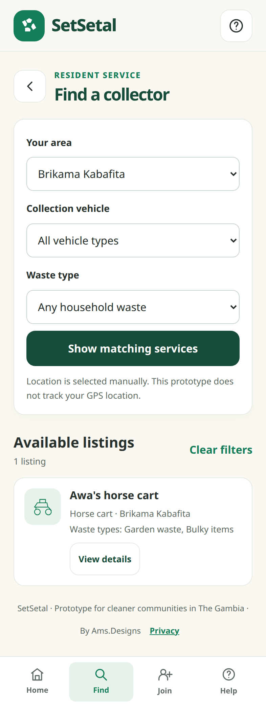

If your area isn't on the list, choose **Other / not listed**. The app says so plainly, and **Go to Help** lets you tell the team where you are, so they know where collectors are needed.

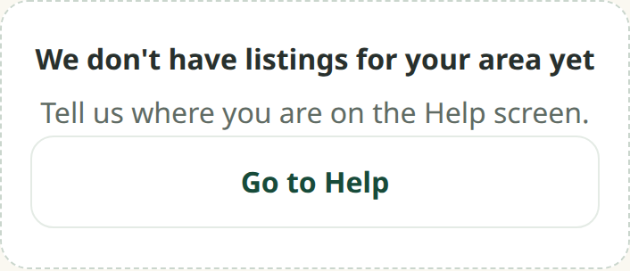

### 3. Contact the collector

Tap **View details** on a listing, then **Call** or **WhatsApp**. WhatsApp opens with a short message already written, which you can change before sending.

You agree the time and the price with the collector. SetSetal doesn't take part in the call or the payment.

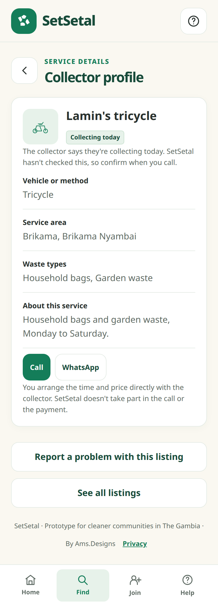

Things to know:

- **No Call button?** The collector has not agreed to show their number. The listing says "No contact details yet".
- **"Collecting today"** is the collector's own word. SetSetal hasn't checked it, so confirm when you call.
- **"Saved 12 Nov. Details may have changed."** means you are offline and looking at a saved copy. Phone numbers are removed from saved copies after two days.

### 4. Report a problem

On the collector's profile, tap **Report a problem with this listing**. To send general feedback instead, tap **Help**.

Choose what it is about, write what happened and tap **Send feedback**.

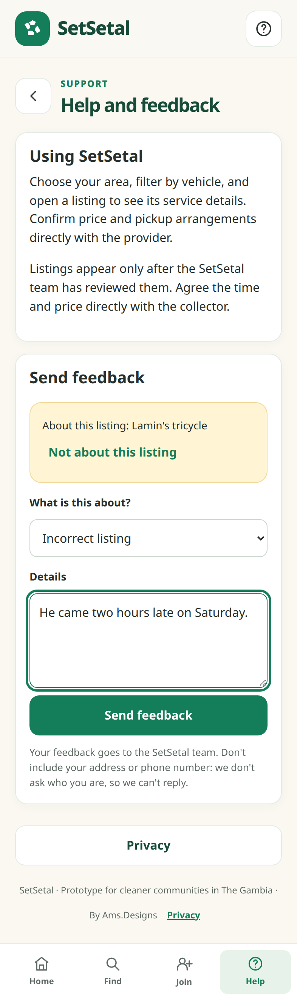

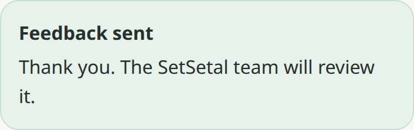

- Reports are anonymous. **Don't put your address or phone number in them**: the team doesn't know who you are and can't reply.
- With no connection, the app says **"Saved on this phone, not sent yet"** and sends the report by itself when you are back online.

### 5. Privacy

**Help → Privacy** (also at the foot of every screen) says in plain words what SetSetal knows about you and what it doesn't.

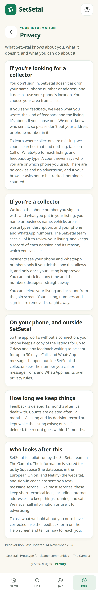

---

## Collectors

### 1. Sign in with your phone

Tap **Join**. Enter your phone number (seven digits is enough for a Gambian number) and tap **Send code**.

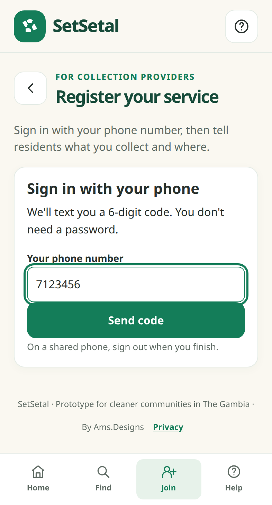

A 6-digit code arrives by SMS. Enter it and tap **Sign in**. There is no password.

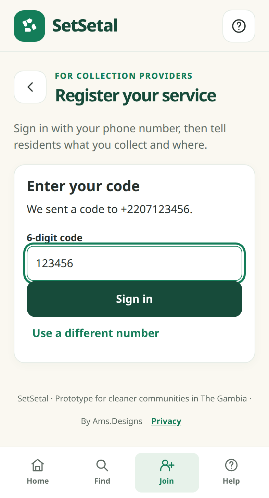

- A small security check may appear above **Send code**. It usually passes by itself.
- **On a shared phone, tap Sign out when you finish.** A sign-in that isn't used for a week ends by itself.

### 2. Describe your service

Fill in your name or business name, the number residents should call, your vehicle, the areas you serve and the waste you take. You can choose several areas and several waste types.

The tick-box **"Show my phone and WhatsApp numbers to residents once my listing is approved"** is your choice. Without it, residents see your listing but can't contact you. You can change it at any time.

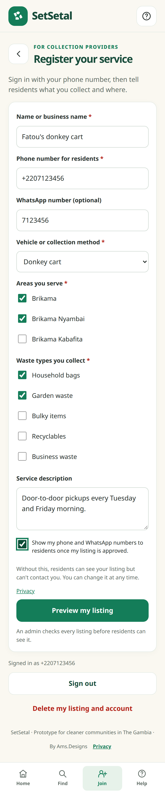

### 3. Check it and submit

**Preview my listing** shows what residents will see. **Edit details** goes back; **Submit for review** sends it to the SetSetal team.

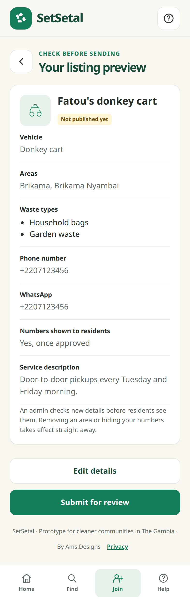

### 4. Wait for the review

Your listing shows **Waiting for review**. Residents can't see it yet. Come back to **Join** at any time to see where it stands.

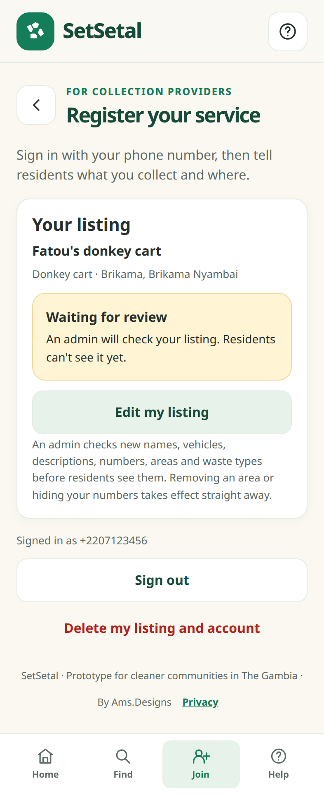

When the team has decided, you see one of these:

| Status | What it means | What to do |
|---|---|---|
| **Approved** | Residents can find you | Nothing |
| **Not approved** | The team's reason is shown | Tap **Edit my listing**, fix what they mention and submit again |
| **Suspended** | Hidden from residents; the reason is shown | Contact the SetSetal team. Editing doesn't bring it back |

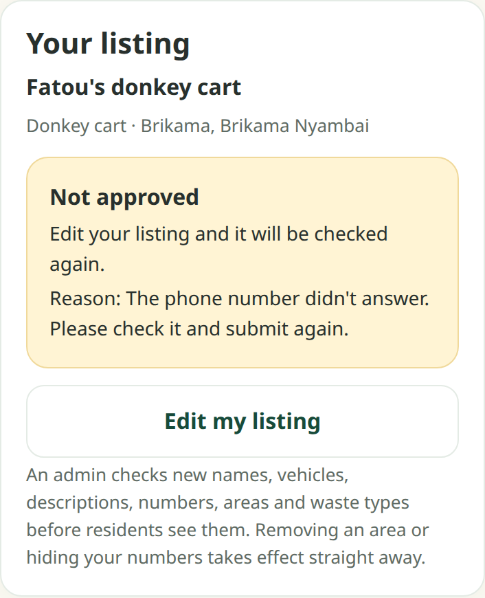

### 5. Say when you're collecting

Once approved, tap **I'm collecting today** on the days you work. Residents see a **Collecting today** label and your listing moves to the top. It switches itself off at midnight, so tap it again the next day.

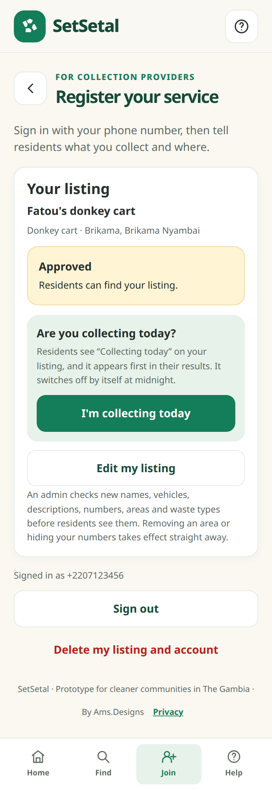

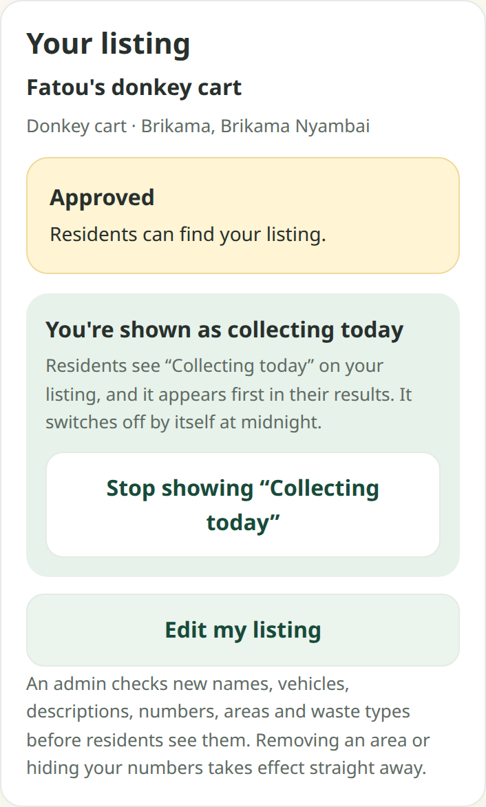

### 6. Change or delete your listing

**Edit my listing** changes anything. A new name, vehicle, description, number, area or waste type is checked by the team again before residents see it, and your listing is hidden while it waits. Removing an area or hiding your numbers takes effect straight away and needs no check.

**Delete my listing and account** removes your listing, your numbers and your sign-in from SetSetal at once. It asks first, and it can't be undone, though you can register again.

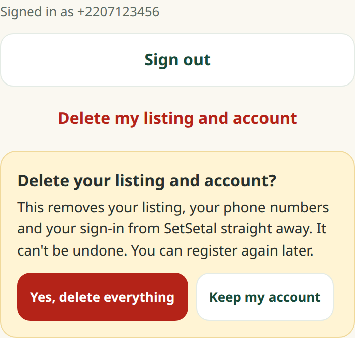

---

## Admins

The admin screen has no button in the app. Open **https://setsetal.netlify.app/#/admin** and keep it as a bookmark.

### 1. Sign in

Tap **Sign in** and use your own phone number and SMS code, as a collector would. The app then checks that your account is on the list of admins. An account that isn't sees "This account isn't an admin".

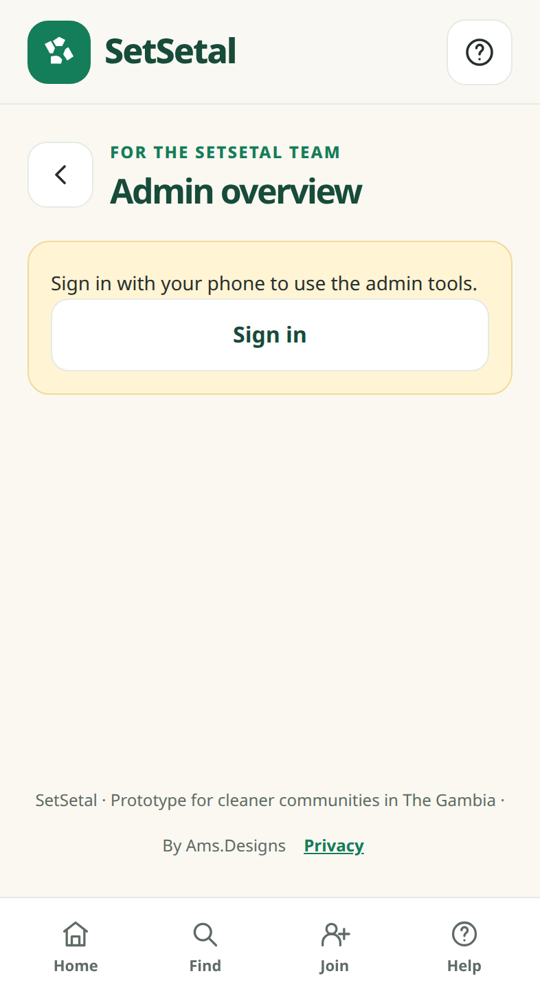

The top of the screen shows what needs attention: listings waiting, open reports and listings that are live. **Refresh**, at the very bottom, loads the latest.

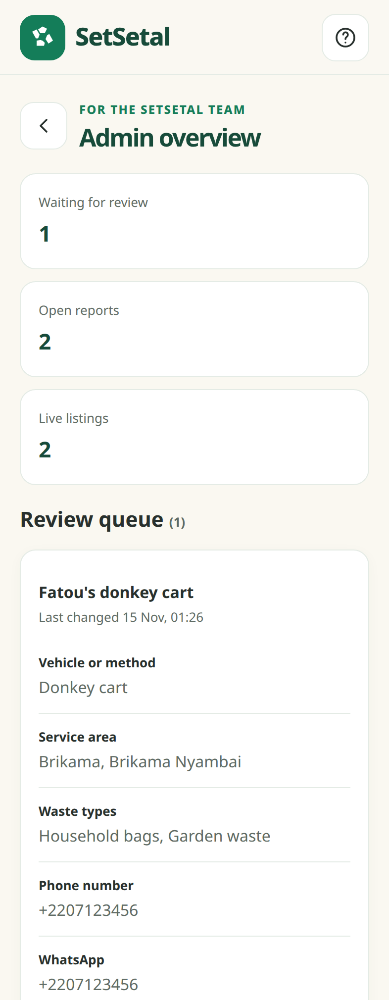

### 2. Review a listing

**Review queue** shows each waiting listing in full, oldest first, including the phone numbers and whether the collector agreed to show them.

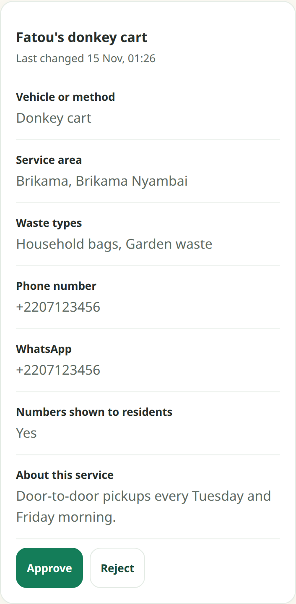

Tap **Approve** or **Reject**, write the reason and tap **Confirm**.

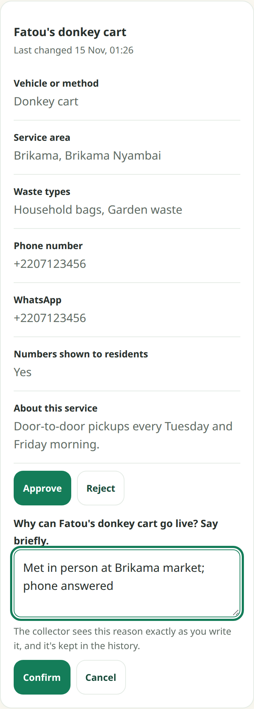

- **A reason is always required, and the collector reads it exactly as you write it.** Write what you checked ("Met in person at Brikama market; phone answered") or what must change ("The phone number didn't answer").
- The reason is also the permanent record that the check happened. Don't write "verified", "licensed" or "official": those words don't have an agreed meaning yet.
- If the collector changed the listing after you opened the screen, the app says **"This changed since you opened it, so nothing was done"** and shows the new version. Read it and decide again.

### 3. Deal with reports

**Open reports** shows what residents sent, oldest first, and which listing each is about. Add a note saying what you did, then tap **Resolve** (you acted on it) or **Dismiss** (nothing to act on).

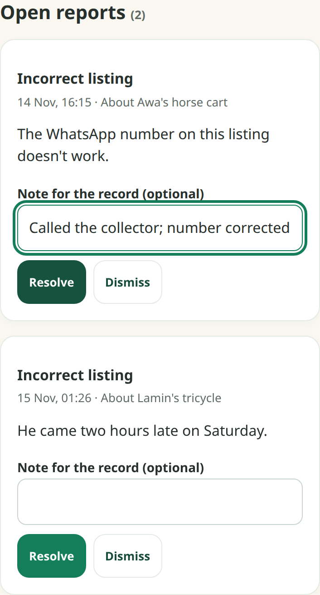

Residents are anonymous, so you can't reply: act on the listing or call the collector. `docs/pilot/complaints-procedure.md` says what to do for each kind of report.

### 4. Suspend, and change your mind

**Live listings** has a **Suspend** button on each listing, for one that should come down. It needs a reason too.

**Rejected and suspended** shows everything hidden from residents. **Reinstate** (or **Approve**, for a rejected one) puts a listing back, again with a reason.

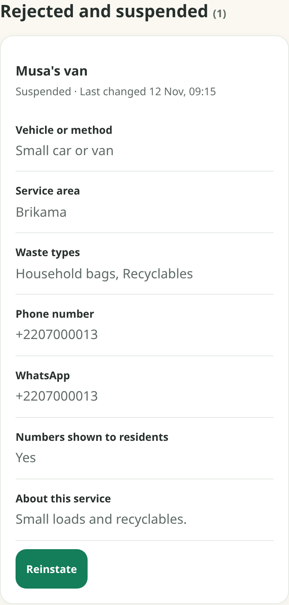

### 5. See what was decided

**Recent decisions** lists every decision on a listing and every closed report, newest first, with its reason or note. **Reopen this report** brings back one that was closed by mistake.

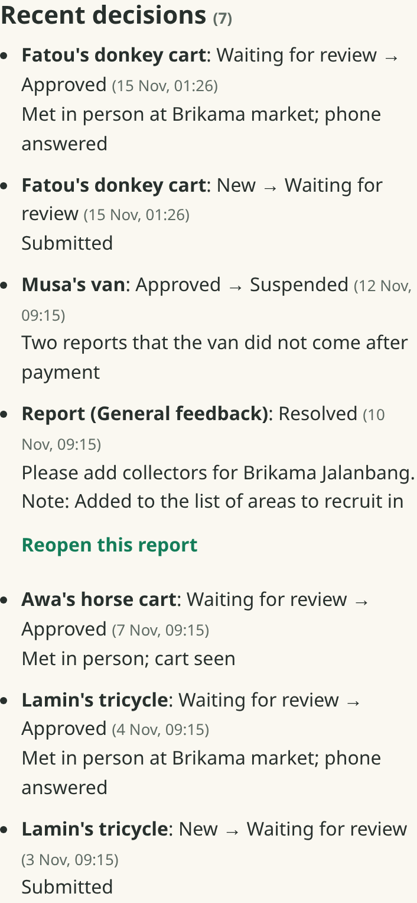

### 6. Manage areas

**Areas** is the list collectors choose from and residents filter by. To add one, type its name and tap **Add area**: it is offered straight away. **Switch off** stops an area being offered; listings that already serve it keep it. Areas can't be deleted.

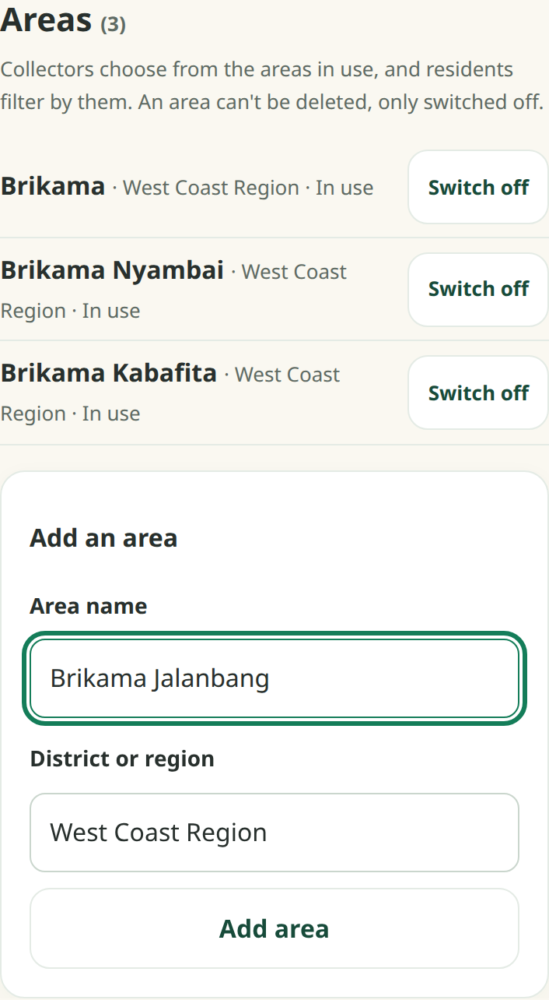

### 7. See how the app is used

**Activity** counts, for the last 30 days: taps on Call or WhatsApp, searches that found nothing, and feedback sent.

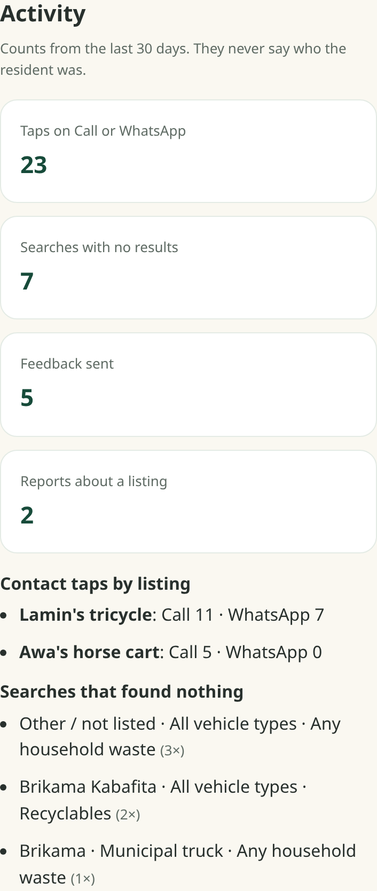

- **Searches that found nothing** shows where residents look and find nobody. Recruit collectors there next.
- **Contact taps by listing** shows which listings are used.
- The counts never say who a resident was. A browser that asks not to be tracked isn't counted.

After an approval, residents see the new listing the next time they open the app.

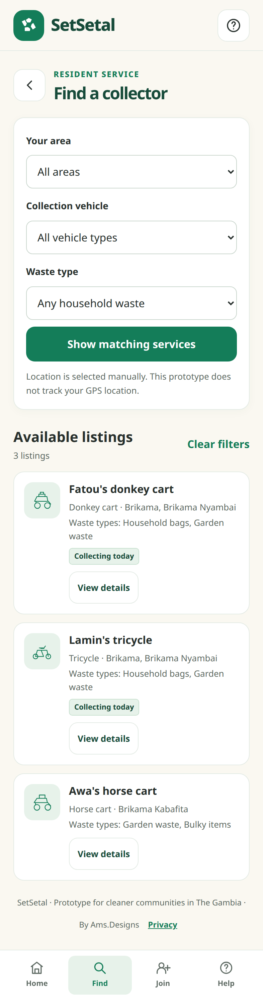

---

## When something doesn't work

| What you see | Why | What to do |
|---|---|---|
| Listings marked **Demonstration listing** | No real collector has been approved yet, or the app couldn't reach the server and has nothing saved | Nothing; they are examples and have no phone numbers |
| **"Sign-in isn't available yet"** | SMS sign-in has not been switched on | See the next section |
| **"Too many attempts"** | Too many codes were requested | Wait a few minutes |
| **"That code didn't work"** | Wrong or expired code | Tap **Use a different number** to start again |
| **"You seem to be offline"** | No connection | Finding collectors still works from the saved copy; signing in and submitting need a connection |
| **No Install app button** | The app is already installed, or the browser isn't Chrome on Android | Use the browser's menu: **Install app** or **Add to Home screen** |
| **"This account isn't an admin"** | The phone number isn't on the admin list | The owner adds it (next section) |

## Before the first real use

The app is built and tested, but these have to be done by the project owner before real collectors can sign up. The full steps are in [docs/pilot/launch-checklist.md](../pilot/launch-checklist.md).

1. **Update the database.** The hosted Supabase project is paused and doesn't have the latest changes. Restore it, then run `supabase db push`.
2. **Switch on SMS sign-in** in Supabase, with a provider and a spending limit.
3. **Add the first admin:** they sign in once, then their account is added to the admin list in the Supabase SQL editor.
4. **Add Brikama's neighbourhoods** on the admin screen under Areas.
5. **Publish:** merge the `adlai_changes` branch into `main`.
6. **Try everything in this guide on a real Android phone.**

Open questions for the owner are in [QUESTIONS.md](../../QUESTIONS.md).
